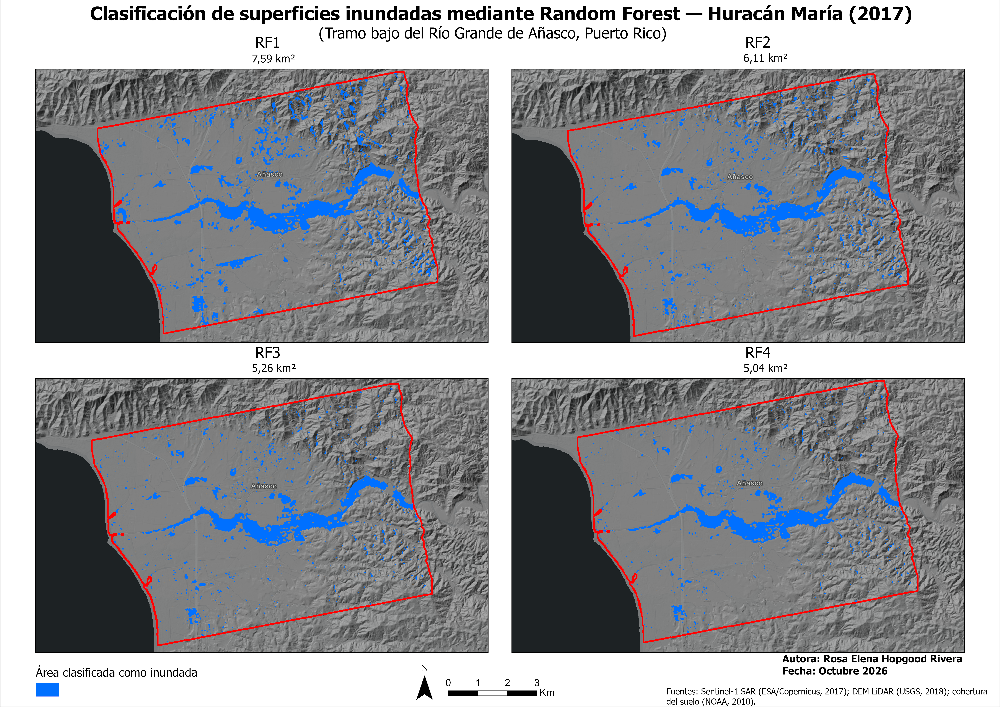
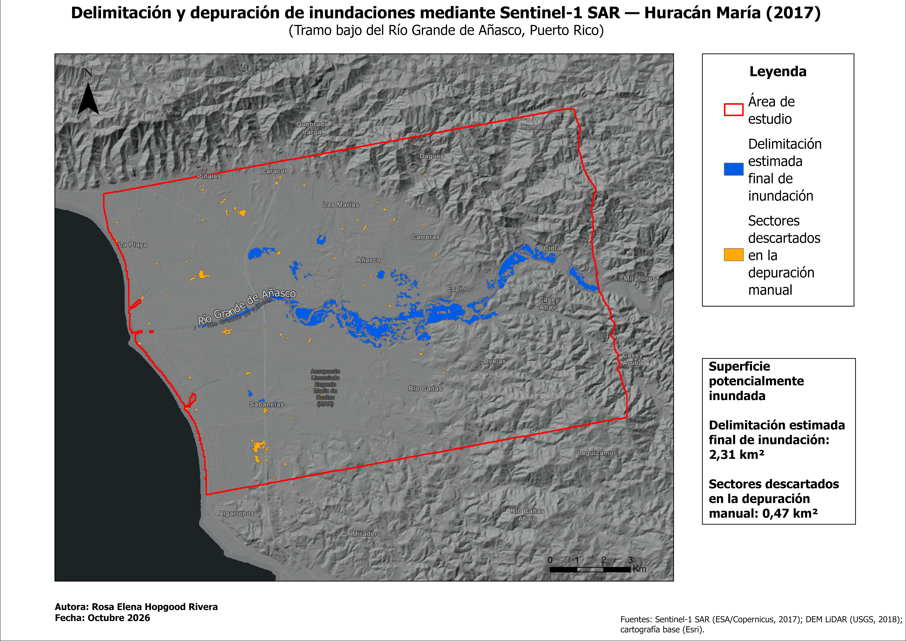

# TFM Automation — Delimitación de inundaciones mediante Sentinel-1 SAR y Random Forest

## 1. Descripción del proyecto

Este proyecto tiene como finalidad automatizar mediante Python distintos procedimientos de análisis geoespacial desarrollados en un Trabajo de Fin de Máster en Sistemas de Información Geográfica (SIG).

La investigación se centra en la delimitación de superficies potencialmente inundadas tras el paso del huracán María, ocurrido el 20 de septiembre de 2017, en el tramo bajo del río Grande de Añasco, situado entre los municipios de Añasco y Mayagüez, Puerto Rico.

La automatización comprende dos líneas principales de trabajo. La primera corresponde al análisis multitemporal de imágenes Sentinel-1 SAR, mediante la evaluación de cambios en la retrodispersión y la aplicación de criterios topográficos para delimitar posibles superficies inundadas. La segunda consiste en la reconstrucción de cuatro modelos de clasificación supervisada Random Forest (RF1–RF4), que incorporan progresivamente variables de teledetección y datos geoespaciales auxiliares.

El proyecto se ha desarrollado principalmente con Python, utilizando como referencia los datos y productos geoespaciales originales procesados mediante SNAP y ArcGIS Pro.

## 2. Área de estudio

El área de estudio se localiza en el tramo bajo del río Grande de Añasco, en el oeste de Puerto Rico, entre los municipios de Añasco y Mayagüez. Comprende una superficie aproximada de **72,61 km²** y un tramo fluvial de **10,79 km** de longitud.

La investigación examina las condiciones de inundación asociadas al huracán María de septiembre de 2017, prestando especial atención a la llanura aluvial y a las características topográficas que influyen en la distribución espacial de las superficies potencialmente inundadas.

## 3. Datos utilizados

El proyecto utiliza imágenes Sentinel-1 SAR obtenidas mediante el programa Copernicus de la Agencia Espacial Europea (ESA), correspondientes al **16 de septiembre de 2017**, como fecha preevento, y al **22 de septiembre de 2017**, como fecha postevento. El análisis multitemporal se realiza principalmente mediante la polarización VH.

### Productos Sentinel-1 utilizados

Para garantizar la identificación precisa de las escenas satelitales empleadas y facilitar la reproducibilidad del análisis, se especifican los productos originales:

**Imagen preevento — 16 de septiembre de 2017**

`S1A_IW_GRDH_1SDV_20170916T223625_20170916T223650_018407_01EFD9_AE4E.SAFE.zip`

**Imagen postevento — 22 de septiembre de 2017**

`S1B_IW_GRDH_1SDV_20170922T223532_20170922T223557_007511_00D430_D309.zip`

Ambos productos corresponden a imágenes Sentinel-1 adquiridas en modo Interferometric Wide Swath (IW), nivel GRD y doble polarización VV/VH. Para el análisis de cambios en la retrodispersión se utilizó principalmente la polarización VH.

Los archivos originales se almacenan localmente en `data/sentinel1/`, pero no se incluyen en el repositorio de GitHub debido a su tamaño. Para reproducir el procesamiento, es necesario disponer de estos productos y colocarlos en dicho directorio.

Estas imágenes se complementan con un Modelo Digital de Elevación (DEM) del Servicio Geológico de Estados Unidos (USGS), utilizado para obtener información de elevación y pendiente; datos de cobertura del suelo de NOAA; información hidrográfica para calcular la distancia al río; e imágenes Sentinel-2 para el contraste visual.

Asimismo, se incorporan las muestras de entrenamiento y los puntos de validación procedentes del proyecto original desarrollado en ArcGIS Pro, permitiendo reconstruir los modelos supervisados y comparar sus resultados con las clasificaciones originales.

| Datos                           | Fuente                          | Aplicación                         |
| ------------------------------- | ------------------------------- | ---------------------------------- |
| Sentinel-1 SAR                  | Copernicus / ESA                | Detección multitemporal de cambios |
| Modelo Digital de Elevación     | USGS                            | Elevación y pendiente              |
| Cobertura del suelo             | NOAA                            | Variable auxiliar de clasificación |
| Red hidrográfica                | Datos hidrográficos del TFM     | Distancia al río                   |
| Sentinel-2                      | Copernicus / ESA                | Contraste visual                   |
| Muestras y puntos de validación | Proyecto original de ArcGIS Pro | Entrenamiento y evaluación         |

## 4. Metodología

### 4.1. Análisis Sentinel-1 SAR

El análisis SAR se fundamenta en la comparación de la retrodispersión registrada antes y después del huracán María. A partir de las imágenes Sentinel-1 en polarización VH, se calcula la diferencia de retrodispersión mediante la expresión:

**ΔVH = VH postevento − VH preevento**

El procedimiento automatizado comprende la preparación de imágenes, su alineación espacial, el cálculo de la diferencia de retrodispersión y la aplicación de criterios topográficos para identificar posibles superficies inundadas.

Entre los criterios evaluados se encuentra un umbral de disminución de retrodispersión de **ΔVH ≤ −3 dB**, combinado con restricciones de pendiente destinadas a reducir detecciones potencialmente incorrectas. Posteriormente se aplican operaciones de filtrado y limpieza espacial para obtener los mapas de inundación reconstruidos.

### 4.2. Clasificación supervisada Random Forest

La segunda línea metodológica consiste en la reconstrucción de cuatro modelos Random Forest, diseñados para evaluar la contribución de distintas variables predictoras a la clasificación de superficies inundadas y no inundadas.

RF1 utiliza exclusivamente la retrodispersión VH preevento y postevento. RF2 incorpora adicionalmente la diferencia de retrodispersión entre ambas fechas. RF3 amplía las variables mediante elevación y pendiente, mientras que RF4 incorpora también la distancia al río y la cobertura del suelo.

| Modelo | Variables predictoras                        |
| ------ | -------------------------------------------- |
| RF1    | VH preevento y VH postevento                 |
| RF2    | RF1 + cambio VH                              |
| RF3    | RF2 + elevación y pendiente                  |
| RF4    | RF3 + distancia al río y cobertura del suelo |

Los modelos se entrenaron mediante `RandomForestClassifier` de scikit-learn, utilizando **100 árboles**, una profundidad máxima de **30**, una selección de **1.000 muestras por clase** y una semilla aleatoria de **42**. Los datos predictivos se trabajaron con una resolución espacial de 10 m.

Estos parámetros permiten aproximar la configuración original empleada en ArcGIS Pro, aunque existen diferencias entre las implementaciones de Random Forest que pueden influir en los resultados.

### 4.3. Validación y comparación espacial

La evaluación de los modelos reconstruidos se realizó utilizando **201 puntos de validación** procedentes del proyecto original. A partir de las predicciones obtenidas se calcularon matrices de confusión, exactitud global, índice Kappa, falsos positivos y falsos negativos.

Adicionalmente, se efectuó una comparación espacial entre los mapas reconstruidos mediante Python y las clasificaciones originales de ArcGIS Pro. Esta comparación permitió examinar la coincidencia de las superficies inundadas mediante el índice de intersección sobre unión (IoU).

El análisis se complementó con la identificación de píxeles reclasificados entre modelos sucesivos y con la evaluación de la distancia al río de determinadas superficies incorporadas o descartadas por RF4.

## 5. Resultados principales

### 5.1. Reconstrucción del análisis SAR

El procesamiento automatizado de las imágenes Sentinel-1 SAR permitió obtener una delimitación candidata de aproximadamente **2,7791 km²** de superficie potencialmente inundada.

Este resultado debe diferenciarse de la delimitación revisada del TFM original, que identificó aproximadamente **2,31 km²**. La discrepancia refleja las diferencias entre el procesamiento automatizado y las operaciones de revisión y delimitación realizadas durante la investigación original.

### 5.2. Resultados de Random Forest

Los cuatro modelos reconstruidos presentaron diferencias tanto en su rendimiento de clasificación como en la extensión de las superficies identificadas como inundadas.

| Modelo | Exactitud global |  Kappa | Superficie clasificada como inundada |
| ------ | ---------------: | -----: | -----------------------------------: |
| RF1    |          91,04 % | 0,8213 |                           7,5871 km² |
| RF2    |          95,02 % | 0,9006 |                           6,1093 km² |
| RF3    |          96,02 % | 0,9204 |                           5,2600 km² |
| RF4    |          96,02 % | 0,9204 |                           5,0373 km² |

Los resultados muestran una mejora en las métricas de clasificación desde RF1 hasta RF3. RF3 y RF4 alcanzaron la misma exactitud global y el mismo índice Kappa en los puntos de validación, aunque generaron diferentes distribuciones espaciales.

La superficie clasificada como inundada disminuyó progresivamente desde RF1 hasta RF4. Sin embargo, esta reducción no demuestra por sí sola una eliminación de falsos positivos, dado que los modelos también incorporaron nuevas superficies a la categoría inundada.

### 5.3. Comparación con los modelos originales de ArcGIS Pro

La comparación espacial permitió cuantificar el grado de coincidencia entre las reconstrucciones y los mapas originales del TFM.

| Modelo | Coincidencia espacial (IoU) |
| ------ | --------------------------: |
| RF1    |                      0,7746 |
| RF2    |                      0,7991 |
| RF3    |                      0,8535 |
| RF4    |                      0,5804 |

RF3 presentó la mayor coincidencia espacial, con un IoU de **0,8535**, mientras que RF4 registró las diferencias más importantes respecto a su clasificación original.

Estas discrepancias podrían estar relacionadas con diferencias en la implementación del algoritmo, los procedimientos de selección de muestras y el tratamiento de determinadas variables predictoras. No obstante, no se ha establecido una causa definitiva.

Los resultados evidencian que obtener métricas de validación similares no garantiza reproducir exactamente la distribución espacial de las clasificaciones originales.

## 6. Organización del proyecto

El proyecto se organiza en tres directorios principales: `data`, `outputs` y `scripts`. La carpeta `data` contiene las imágenes satelitales, los datos geoespaciales auxiliares y las muestras originales de entrenamiento y validación. Por su parte, `outputs` almacena los rásteres procesados, los modelos entrenados, las clasificaciones y los resultados obtenidos durante los análisis.

La carpeta `scripts` contiene los programas Python utilizados para automatizar los procedimientos del proyecto. Para facilitar su consulta, se han creado tres subcarpetas temáticas: `sar_analysis`, destinada al procesamiento de imágenes Sentinel-1 SAR y la delimitación de inundaciones; `random_forest`, dedicada a la preparación de muestras, entrenamiento, clasificación y validación de los modelos; y `common`, que reúne herramientas auxiliares para la inspección y comprobación de datos geoespaciales.

La estructura general del proyecto es la siguiente:


```text
TFM_Automation/
├── data/
├── outputs/
├── scripts/
│   ├── common/
│   ├── random_forest/
│   │   └── archived_experiments/
│   ├── sar_analysis/
│   └── archivos Python originales
├── .venv/
├── requirements.txt
├── README.md
├── SAR_WORKFLOW.md
├── RANDOM_FOREST_WORKFLOW.md
└── run_random_forest.bat
```

La carpeta `random_forest` contiene 26 scripts organizados correspondientes a los procedimientos de preparación, entrenamiento, clasificación y validación de los modelos RF1–RF4. Los tres scripts experimentales relacionados con RF5 se conservan por separado en `archived_experiments`, sin formar parte del flujo de trabajo definitivo. Los scripts originales permanecen directamente en `scripts` para preservar sus rutas de ejecución y funcionamiento.

## 7. Entorno de trabajo

La automatización se desarrolló en un entorno Windows utilizando Visual Studio Code como editor de código y un entorno virtual de Python denominado `.venv`.

El procesamiento geoespacial se apoya principalmente en Rasterio, GeoPandas, NumPy y SciPy, mientras que la implementación de Random Forest utiliza scikit-learn. También se emplea Joblib para guardar y recuperar los modelos entrenados.

ArcGIS Pro y SNAP se utilizaron como herramientas complementarias para el procesamiento inicial, la preparación de determinadas capas y la comparación con los resultados originales del TFM.

Las dependencias y sus versiones se encuentran registradas en el archivo `requirements.txt`. Para instalarlas en un entorno virtual compatible, se utiliza el siguiente comando:

```powershell
python -m pip install -r requirements.txt
```

La reconstrucción del entorno dependerá de la compatibilidad de las versiones de Python y de las bibliotecas registradas.

## 8. Ejecución

Los scripts deben ejecutarse desde el directorio principal del proyecto `TFM_Automation`, manteniendo la estructura de carpetas y las rutas de entrada utilizadas durante el desarrollo.

Por ejemplo, la generación de los cuatro mapas Random Forest reconstruidos se realiza mediante:

```powershell
python .\scripts\predict_rf_all_arcgis_parameters.py
```

Este script utiliza los modelos entrenados previamente y los rásteres multibanda originales para generar los mapas de clasificación RF1–RF4 en formato GeoTIFF.

Los demás scripts permiten realizar operaciones específicas relacionadas con el procesamiento de Sentinel-1, preparación de datos auxiliares, generación de máscaras de inundación, entrenamiento de modelos, validación y comparación espacial.

Actualmente, el proyecto contiene scripts independientes correspondientes a distintas fases del procesamiento, pero no dispone de un ejecutor único que permita reproducir automáticamente todo el flujo de trabajo desde los datos brutos.

## 9. Limitaciones

Aunque la automatización ha permitido reconstruir gran parte de los procedimientos desarrollados durante el TFM, los resultados no reproducen exactamente todas las clasificaciones originales de ArcGIS Pro.

Las diferencias observadas pueden estar relacionadas con las particularidades de las herramientas empleadas, los procedimientos internos de entrenamiento de Random Forest y determinadas decisiones metodológicas aplicadas durante el procesamiento original.

Asimismo, la coincidencia de las predicciones en los puntos de validación no garantiza una correspondencia espacial completa entre los mapas. Por esta razón, se considera necesario distinguir entre la precisión de clasificación y la fidelidad espacial de la reconstrucción.

Las superficies clasificadas como inundadas deben interpretarse como resultados de modelos geoespaciales sujetos a incertidumbre, cuya evaluación requiere contraste con información independiente.

Finalmente, algunas etapas del TFM original incluyeron operaciones de revisión e interpretación espacial realizadas manualmente, que no fueron reproducidas íntegramente mediante Python.

## 10. Reproducibilidad y disponibilidad de datos

El repositorio contiene los scripts Python, los gráficos de procesamiento SNAP, la documentación metodológica y las composiciones cartográficas elaboradas durante el proyecto.

Debido a su tamaño, los productos satelitales originales, los datos geoespaciales auxiliares, los modelos entrenados y los rásteres resultantes no se incluyen en el repositorio.

Para reproducir los procedimientos es necesario disponer de los datos Sentinel-1 identificados en la sección 3, instalar las dependencias especificadas en `requirements.txt` y configurar las rutas externas correspondientes.

El archivo `.env.example` proporciona una referencia para configurar la ubicación del ejecutable de ESA SNAP y de los datos DEM. Estas variables deben establecerse en el entorno de ejecución, ya que los scripts no leen automáticamente dicho archivo.

Se han realizado comprobaciones de sintaxis, importación de bibliotecas, dependencias y disponibilidad de archivos. Asimismo, se ha verificado la ejecución del operador `Apply-Orbit-File` de SNAP utilizando una imagen Sentinel-1 preevento y una carpeta de pruebas independiente.

Estas verificaciones no constituyen una reproducción integral y automática de todos los resultados, ya que el proyecto se compone de scripts independientes correspondientes a distintas etapas del procesamiento.

## 11. Resultados cartográficos

Como parte de la documentación final del proyecto, se elaboraron dos composiciones cartográficas para presentar los resultados de los análisis Sentinel-1 SAR y Random Forest.

### Comparación de modelos Random Forest (RF1–RF4)

La siguiente figura presenta las superficies clasificadas como inundadas mediante los cuatro modelos Random Forest reconstruidos en Python.



### Delimitación de inundaciones mediante Sentinel-1 SAR

La siguiente figura muestra la delimitación automatizada de superficies potencialmente inundadas y los cambios realizados durante la depuración manual.



Ambas composiciones fueron elaboradas en ArcGIS Pro utilizando los resultados obtenidos mediante Python.

